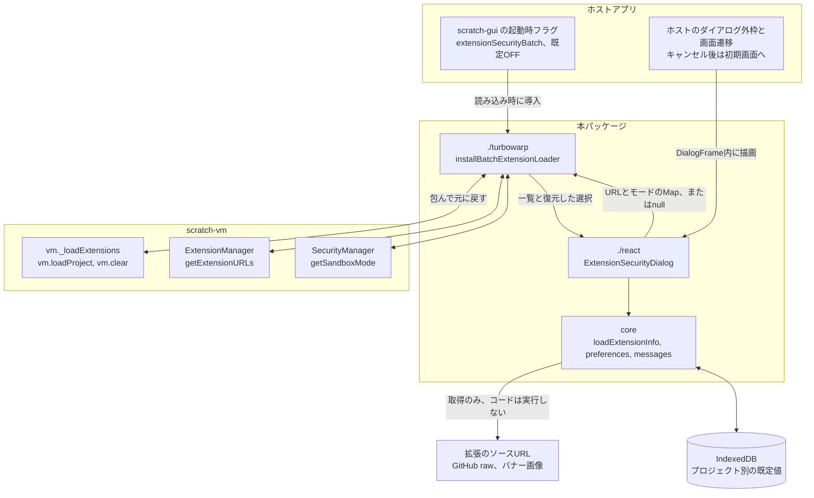
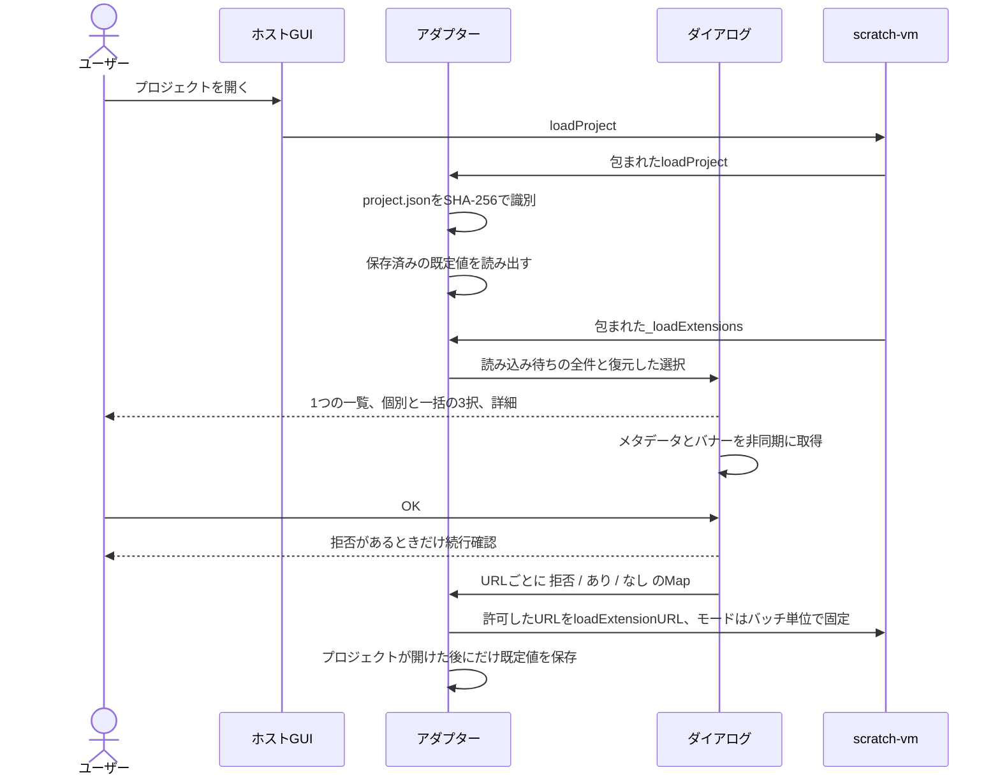

# turbowarp-extension-security-dialog

[English](README.md) | 日本語

TurboWarpの複数の機能拡張を、1つの一覧で確認するための共通パッケージです。
関連タスクと受け入れ基準は [scratch-gui #33](https://github.com/kubohiroya/scratch-gui/issues/33) に記録しています。

## Pagesのカタログから機能拡張を選択する

`ExtensionSelectionList` は既存のバナー・メタデータ・詳細表示を共有し、各行の右端へチェックボックスを1つ表示します。
TurboWarp Plus一覧の対応範囲は [#28](https://github.com/kubohiroya/turbowarp-extension-security-dialog/issues/28) に記録しています。
ホスト側でGitHub PagesのJSONをHTTPS取得し、このコンポーネントへ渡します。

```jsx
import {loadExtensionCatalog} from '@kubohiroya/turbowarp-extension-security-dialog';
import {ExtensionSelectionList} from '@kubohiroya/turbowarp-extension-security-dialog/react';

const controller = new AbortController();
const entries = await loadExtensionCatalog(
  'https://kubohiroya.github.io/turbowarp-plus-packages/extensions-v1.json',
  controller.signal
);

const list = <ExtensionSelectionList entries={entries} locale="ja"
  filterQuery={searchText} loadedIds={loadedExtensionIds} busy={loading}
  onCancel={closeLibrary}
  onComplete={ordered => host.reviewAndLoadInOrder(ordered)} />;
```

例の `host.reviewAndLoadInOrder` はホスト側で実装する実行許可確認・VM読み込み処理です。
`onComplete` は依存先を先に並べた重複のない配列を返し、`loadedIds` は除外します。
ある拡張を選ぶと推移的な依存先すべてがchecked・disabledになります。
親を解除すると依存関係を再計算し、ほかの選択やユーザー自身の明示選択が必要としている拡張は選択を保ちます。
読み込み済みの行はchecked・disabledです。検索と表示言語を切り替えても選択を保ちます。
`busy` で選択・フッター操作を無効にします。取得失敗・再試行・カタログの取得中止・VMエラーの表示と、
読み込み成功に応じた `loadedIds` 更新はホスト側の担当です。

一覧の表示・選択だけでは機能拡張のコードを読み込み・実行しません。
JSONのメタデータを直ちに表示し、「詳細」を開いたときだけソースを文字列として取得します。
取得に失敗してもカタログのメタデータと選択は利用できます。
実行許可確認には `ExtensionSecurityDialog context="catalog"` を使用でき、キャンセル文言が選択一覧へ戻る案内になります。
既定の `context="project"` はプロジェクト読み込み用の文言を維持します。
ホストは確定された実行モードと独自のセキュリティ方針を尊重して読み込んでください。

JSON契約は `schemaVersion: 1` と `extensions` 配列です。各要素の必須項目は次のとおりです。

| 項目 | 内容 |
| --- | --- |
| `id` | ASCII英数字の機能拡張ID |
| `name` | 表示名 |
| `version` | 配布バージョン |
| `url` | バージョン固定の公開済み機能拡張JSへのHTTPS URL |
| `dependencies` | 同じJSONに含まれる依存先の機能拡張ID配列。npmパッケージ名ではない |

`package`・`description`・`descriptions`（`ja`等の小文字言語タグをキーとする説明）・`author`・`license`・
`banner`・`repository`・`unsandboxed`（例: `required`）は任意のメタデータです。
完全なJSON例は[英語版のAPI例](README.md#selecting-extensions-from-a-pages-catalog)を参照してください。
生成側でパッケージ依存を拡張IDへ変換し、ビルド専用パッケージを除外します。

`parseExtensionCatalog` は未対応schema、ID/URL重複、存在しない依存先、循環依存、HTTPS以外や認証情報付きのURLを拒否します。
`resolveExtensionSelection(entries, explicitIds, loadedIds)` はReactなしでも同じ選択集合・依存順を計算します。
`loadExtensionCatalog` は任意のAbortSignalを受け付け、認証情報・Refererを送らずに取得し、HTTP失敗や不正なJSON契約を例外として返します。

切り戻しはホストの起動時固定・既定OFFのフラグをOFFにして再読み込みするか、カタログ接続差分をrevertします。
既存の3つの実行モードを持つセキュリティ確認は、そのまま利用できます。

## 公開Editorのスクリーンショット

[英語版](./README.md)と日本語版は、同じダイアログの表示言語を切り替え、ラベルと拡張の説明文を各言語で表示しています。
全件必須時の自動選択と一括選択欄の非表示に対応した[公開Editor](https://kubohiroya.github.io/turbowarp-extension-data-editor/editor.html?lang=ja)で、
2026年10月28日にCamera Source 0.19.4・Asset Cache 0.3.2・Bubble 0.13.5を開いた実画面です。


3拡張とも`Unsandboxed: required`を宣言しています。「拒否」と「サンドボックスあり」は無効化され、
理由が表示されます。「サンドボックスなし」だけが有効で、「動作に必要」と表示します。
全拡張がこのモードを必要とする場合、全件のメタデータ取得後に選択済みになり、一括選択欄は非表示になります。
「OK」で続行するか、「キャンセル」でプロジェクトの読み込みを中止します。
必要なモードの表示は、安全性や配布元の信頼性の認定ではありません。

| 機能拡張 | サンドボックスなしが必要な理由 |
| --- | --- |
| Camera Source | ホストの実行環境を通して、1つのブラウザーカメラ映像を複数の拡張で共有し、カメラ選択と左右反転の操作を提供します。ブラウザーのカメラ使用許可は別の判断です。 |
| Asset Cache | ホストの実行環境と描画機能へ直接アクセスして、保持した画像・音声・実行時テキストを作品へ表示・再生します。 |
| Bubble | ホストの実行環境と描画機能へ直接アクセスして、ステージ上に重ねた吹き出しや立ち絵を描画・更新します。 |

画像はダイアログ部分をブラウザーで直接撮影したもので、加工していません。
取得元の版・Editor build・画像hashは[撮影台帳](./assets/screenshots/hidden-bulk-required-20261028.json)に記録しています。

## 連動するパッケージ

このパッケージは、ホストのGUIと `scratch-vm` の間に入ります。scratch-vmのソースや
`node_modules` 内の依存パッケージは書き換えません。アダプターは実行時にインスタンスの
メソッドを数個だけ包み、元に戻すための `restore()` を返します。



| パッケージ | 関係 |
| --- | --- |
| `scratch-vm` | 包むだけで、変更しません。`_loadExtensions` に割り込み、最初の拡張が動き出す前に**すべての**許可を決めます。`loadProject` と `clear` が1回の読み込みに範囲を限り、`getSandboxMode` はバッチ単位で固定し、`getExtensionURLs` は拒否したブロックのソースURLを保持して、保存し直しても失われないようにします。 |
| `scratch-gui` / TurboWarp Editorフォーク | ホスト側です。既定OFFの起動時フラグ、`DialogFrame` として渡すモーダルの外枠、確認済みキャンセル後のエディター初期画面への遷移を担当します。ホスト独自のセキュリティポリシーが優先されます。 |
| `react`、`react-dom` | 任意のpeer dependencyで、React UIの利用時にだけ必要です。coreとVMアダプターには不要です。 |
| `@turbowarp/jszip` | プロジェクト別の既定値のために、`sb3` から `project.json` を読み出して識別します。 |

## 表示するダイアログ

1回のプロジェクト読み込みにつき1つのダイアログで、読み込み待ちの拡張URLをすべて並べます。
各行には「拒否」「サンドボックスあり」「サンドボックスなし」の3択があり、一括選択は対応する
拡張すべてに同じ選択を適用します。見出し・一括選択・OK/キャンセルは常に見えたままで、
一覧だけがスクロールします。下図では列見出しを「あり」「なし」と省略していますが、
実際は「サンドボックスあり」「サンドボックスなし」と表示します。

```
+--------------------------------------------------------------------------+
| 機能拡張セキュリティ                                                     |
| 実行方法を選んでください（取得中でも選択できます）                       |
|                                             機能拡張の情報：2/3 件を確認 |
|                                                                          |
| 表示中のすべてに適用: [(x) 拒否] [(o) あり] [(!) なし]                   |
| そのモードに対応する拡張だけに適用します。                               |
| +----------------------------------------------------------------------+ |
| | 機能拡張                |   (x) 拒否   |   (o) あり   |   (!) なし   | |  <- この領域だけが
| +----------------------------------------------------------------------+ |     スクロールする
| | [バナー] Fetch          |     ( )      |    非対応    |     (*)      | |
| |   作者 ... | ID: fetch | ライセンス: MIT | 更新日時 ...              | |
| |   (!) この拡張はサンドボックス内では動作しません。                   | |
| |       サンドボックスなし: 動作に必要                        [ 詳細 ] | |
| +----------------------------------------------------------------------+ |
| | [バナー] Storage        |     (*)      |     ( )      |     ( )      | |
| |   メタデータを取得中…                                       [ 詳細 ] | |
| +----------------------------------------------------------------------+ |
| メタデータは作者の自己申告です。                                         |
| サンドボックスなしの拡張は、プロジェクトやブラウザーの                   |
| 情報にアクセスできます。                                                 |
| 拒否 1 · あり 0 · なし 1 · 未指定 1                                      |
|                                             [ キャンセル ]    [  OK  ]   |
+--------------------------------------------------------------------------+
```

続いて、2種類の確認ダイアログが出ることがあります。

- **読み込みのキャンセル** — 「このプロジェクトの読み込みをキャンセルし、TurboWarp Editorの
  初期画面に戻ります。キャンセルしますか？」確認済みのキャンセルだけが読み込みを中断します。
  そのVMエラーは `isExtensionSecurityCancelled(error)` で識別できます。
- **機能拡張を拒否して続行** — 「このプロジェクトの実行をする際に、作者が意図した動作を
  できない可能性があります。続行しますか？」「いいえ」なら一覧に戻り、何も保存しません。

バナーはホバーまたはキーボードフォーカスで原寸プレビューを表示します。画面より大きい画像は
プレビュー枠内をスクロールして確認できます。ソースコードを一覧内に表示するのは「詳細」だけです。



## 本来あるべき実装場所

**この機能は、本家のTurboWarp Editorで実装されているべきものです。** 信頼できない拡張コードを
どう実行するかの判断は、エディター自身のセキュリティ境界に属するもので、プロジェクト側が
後付けするべきものではありません。拡張コードが動き出す前に確認が終わっていなければならず、
ユーザーがまとめて判断できるようプロジェクト内の全拡張を一度に扱わなければならず、その結果は
保存と再読み込みをまたいで残らなければなりません。下流のパッケージにできるのは、ホストの
メソッドを実行時に包んでそこに近づけることだけです。

**作者は、このパッケージが有用なものであると信じ、その信念のもとで公開しています。** 本家が
これを満たすまでの間、どのTurboWarpホストでも既定OFFのフラグの背後で一括確認を今すぐ
導入できますし、このパッケージは、挙動・日本語と英語の文言・互換境界を示す、本家実装のための
動く参考実装にもなります。TurboWarp Editorによってこのパッケージが不要になるなら、作者は
それを喜びます。

## 責務

- 一覧比較UI、個別・一括の3択、確認ダイアログ、ソースの詳細表示
- コードを実行しないメタデータ取得、実バナー／GitHub画像の候補選択、共通バナーへの切替
- 画像・メタデータの非同期更新と独立した選択・詳細の状態保持
- プロジェクト別のIndexedDB保存と初期選択の復元
- `./turbowarp` に分離したVM互換アダプター

ホスト側が、ダイアログの外枠、起動時フラグ、キャンセル後の初期画面への移動を担当します。
ReactとReact DOMは任意のpeer dependencyです。React UIの利用時は両方を用意してください。
coreとVMアダプターの利用にReact/React DOMは必要ありません。

ダイアログ全体の高さをビューポート内に制限し、見出し・一括選択・OK/キャンセルを維持したまま、
一覧（詳細と注意書きを含む）だけをスクロールします。短い画面高では余白を詰めます。

## メタデータとプレビュー

HTTP/HTTPSの出所URLは完全なURLを表示し、別タブで開きます。埋め込み拡張や他のスキームはリンクにしません。
ソース先頭の宣言コメントに `// Updated: 2026-10-19T10:30:00+09:00` などの更新日時がある場合、
記載値をそのまま表示します。`Updated at` / `Updated-at` / `UpdatedAt` / `Last updated` / `Last-updated` /
`Last modified` / `Last-modified` も同じ項目です。カスタム `loadInfo` は `metadata.updatedAt` を返せます。
記載がなければ日時は表示せず、HTTPの取得日時やファイル時刻で補いません。

バナーはホバーまたはキーボードフォーカスで原寸プレビューを表示します。画面より大きい画像は
プレビュー枠内をスクロールして確認できます。ポインターを外すかEscapeで閉じ、選択や詳細状態を保持します。
メタデータの非同期取得中も実行方法を選べます。ソースの一覧内表示は引き続き「詳細」を押したときだけです。

### 機能拡張の説明文の言語

拡張コードを実行せず、任意の言語別ヘッダーコメントを読み取ります。

```js
// Description: Share one camera stream between extensions.
// Description[ja]: 1つのカメラ映像を複数の機能拡張で共有します。
// Description[ja-JP]: 日本語の説明（日本向け）。
```

言語タグの大文字・小文字は区別しません。Editorの言語の完全一致、基底言語、従来の`Description`の順で説明文を選びます。表示中に言語を変えると、ソースを再取得せず説明が切り替わり、許可の選択状態は保たれます。翻訳がない既存の拡張も従来どおり表示できます。

同梱メンバーのnoticeにある説明は親バンドルへ混ぜません。HTMLに見える説明も文字列として表示します。独自の`loadInfo`を使う場合は、任意の`ExtensionMetadata.descriptions`へ小文字の言語タグをキーとした説明を渡せます。`getExtensionDescription(metadata, locale)`でも同じ選択処理を利用できます。

上の画像は、日本語説明へ対応した公開Editorと公開済みの3拡張を使用しています。英語版では各拡張の従来の`Description`、日本語版では`Description[ja]`を表示します。対応する翻訳がない拡張は元の説明を表示します。説明の言語が変わっても、必要な実行モードや許可の選択は変わりません。パッケージを更新しても、既存SB3に埋め込まれたコードは自動で差し替わりません。

## 実行モードの選択

個別選択・一括選択・一覧の見出しは、禁止アイコンの「拒否」、盾の「サンドボックスあり」、
警告の「サンドボックスなし」の順です。アイコンと色は文字ラベルを補助し、安全性の認定には使いません。

先頭の宣言コメントに `// Unsandboxed: required` があれば、「拒否」と「サンドボックスあり」を無効化して
理由を表示し、選択できる唯一のモード「サンドボックスなし」に「動作に必要」を付けます。
選択したモードを「OK」で承認するか、「キャンセル」でプロジェクトの読み込みを中止します。
この宣言は作者の自己申告であり、未宣言・取得失敗から必須モードを推測しません。

「拒否」を含む選択の確定はメタデータ取得の完了または失敗後です。全拡張の取得が成功し、すべてが
この必須モードを宣言していれば、非対応の保存済み選択も含めて「サンドボックスなし」を選択済みにします。
「OK」を押すまで拡張は実行せず、「キャンセル」で中止できます。取得中・未宣言・任意指定・取得失敗が
1件でもあれば、この一括初期選択は行いません。混在する一覧では、非対応の選択を解除して選び直しを案内します。
一括選択は対応する拡張だけに適用し、全件が非対応の一括ボタンは無効化します。

## 接続例

```jsx
import {ExtensionSecurityDialog} from '@kubohiroya/turbowarp-extension-security-dialog/react';
import {installBatchExtensionLoader} from '@kubohiroya/turbowarp-extension-security-dialog/turbowarp';
import '@kubohiroya/turbowarp-extension-security-dialog/styles.css';

const restore = installBatchExtensionLoader(vm, (entries, initialChoices) =>
  new Promise(resolve => showDialog(
    <ExtensionSecurityDialog entries={entries} initialChoices={initialChoices}
      locale="ja" DialogFrame={HostModal} onComplete={resolve} />
  )), defaultExtensionURLs);
```

`onComplete` は確定したMap、または確認済みキャンセルの `null` を返します。
キャンセル時のVMエラーは `isExtensionSecurityCancelled(error)` で識別できます。
Webpack 4のCSS Modules環境では `styles.css` の代わりに `webpack4.css` を読み込みます。
従来のWebpack 4がpackage exportsを解釈しない場合にも、ルートの互換entryを解決できます。

## 設定の保存

OKで確定し、プロジェクトが正常に開いた場合だけ保存します。復元値も明示的なOKが必要です。
キャンセル、続行確認の「いいえ」、読み込み失敗では設定を上書きしません。
project.jsonの内容をSHA-256で識別し、編集環境メタデータとJSONのキー順を除外します。
ファイル名では識別しません。内容が変わったプロジェクトは別の設定として扱います。
保存する拡張URLもハッシュ化し、設定DBへソースコードを複製しません。
IndexedDBや暗号APIが利用できない環境でも、許可確認と読み込みを続行できます。

## ホスト互換境界

現在のアダプターはVMインスタンスの `_loadExtensions`、`loadProject`、`clear` と、
ExtensionManagerの `getExtensionURLs`、SecurityManagerの `getSandboxMode` を包みます。
scratch-vmのソースやnode_modules内の依存パッケージは編集しません。
アダプターを破棄する際は返された `restore()` を呼びます。
scratch-guiは既定OFFの起動時フラグで導入し、ホスト独自のセキュリティポリシーを優先します。

## 開発と検証

```sh
pnpm install
pnpm test
```

GUIとの統合では、実VMでの拒否後の表示・保存、エディター初期画面への遷移、
実ブラウザーのIndexedDB復元も検証します。GitHub画像の取得に失敗した場合は共通バナーを使います。

## ロールバック

ホストの `extensionSecurityBatch` をOFFにして再読込すると既存の確認経路へ戻ります。
必要なら共通依存とホストの接続差分を一体でrevertします。保存済み作品の形式は変えません。

## ライセンス

GPL-3.0-only です。画像の出典は [LICENSE](./LICENSE) と [NOTICE.md](./NOTICE.md) を参照してください。
