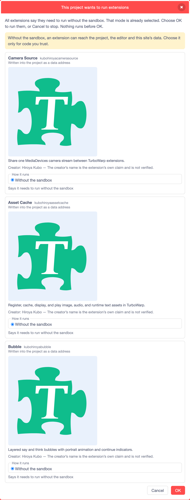

# @kubohiroya/turbowarp-extension-security-dialog

One screen that asks how a project's extensions may run, and the wiring that puts it in front of
a person before any extension code starts.

Licensed under [MPL-2.0](LICENSE). It carries no "Incompatible With Secondary Licenses" notice, so
it can be combined into a larger work distributed under GPL-3.0 — which is how the TurboWarp-Plus
Editor ships it.

## The problem it solves

A VM loads extensions one at a time and asks about each as it goes. Opening a project becomes a
queue of prompts, and the first extension starts before the person has seen the last one. Adding
an extension asks twice: once to pick it, once to allow it.

This package collects the whole project, puts one question, and only then loads anything.

## Public Editor screenshots

This is the [public Editor](https://kubohiroya.github.io/turbowarp-plus-editor/editor.html?lang=en) on
3 November 2026, opening the published Camera Source 0.19.4, Asset Cache 0.3.2 and Bubble 0.13.5 bundles.
All three declare unsandboxed execution required, so that is the only execution choice shown and is already selected.
The other two execution choices and execution bulk control are absent. OK runs the extensions; Cancel stops loading.
No extension has run before OK.



The same dialog was captured in [Japanese](./README.ja.md). These are unmodified dialog-only browser captures.
Distribution and image hashes, pinned Editor revisions and the checks for both languages are recorded in
[the capture manifest](./assets/screenshots/all-required-open-20261103.json).

## Entry points

| Import | What it is |
| --- | --- |
| `.` | Reading a catalog, reading an extension's own description, closing a selection over its dependencies, remembering what the opener chose, the wait dialog, wording |
| `./react` | `ExtensionReview`, the screen |
| `./turbowarp` | `installBatchExtensionLoader`, which wraps a VM so the question comes first |
| `./styles.css`, `./webpack4.css` | The screen's styles; the second has class names wrapped in `:global()` for a CSS-modules build |

## The screen

```jsx
import {ExtensionReview} from '@kubohiroya/turbowarp-extension-security-dialog/react';
import '@kubohiroya/turbowarp-extension-security-dialog/styles.css';

<ExtensionReview
    mode="open"            // or "add"
    entries={entries}
    locale="ja"
    DialogFrame={HostModal} // used only when opening
    loadInfo={loadExtensionInfo}
    onComplete={decisions => {/* a Map, or null when the person said no */}}
/>
```

Adding and opening differ in what is on the list and what can be chosen, not in how the question
is put, so they are the same component.

| | `add` | `open` |
| --- | --- | --- |
| What is listed | Catalog entries; dependencies are selected for you | Every extension the project uses |
| Picking | Tick to choose | None: the project already names them |
| How it runs | In the sandbox, or without it | Do not run, in the sandbox, or without it |
| Where it loads from | Any of the four forms | Only whether a `remote-cacheable` row keeps its copy; every other row states how it loads |
| All at once | Both choices | How they all run, and the copy where at least one row has one to decline |

### The four loading forms

An extension's bytes are held in one of four ways, spelled the same by the Loader's manifest, by
the SB3 save format and by this screen, so a host wires the two ends together without a
translation table.

| Form | This browser | The project file | Standard TurboWarp |
| --- | --- | --- | --- |
| `remote-non-cacheable` | Keeps nothing | A reference | Cannot open it |
| `remote-cacheable` | May keep a verified copy | A reference | Cannot open it |
| `embedded-file` | Nothing to keep | The bytes, as a file in the archive | Cannot open it |
| `embedded-data` | Nothing to keep | The bytes, as a `data:` value | **Can open it** |

**All four are the author's decision**, made when the extension was added, which is why `add`
offers all of them and `open` offers almost none. The one thing left to the person opening a
project is whether a `remote-cacheable` row actually leaves its copy in this browser, and that can
only be declined: `remote-non-cacheable` is the author forbidding the copy, and there is no way to
write permission back over it. So `loadingChoices` reads the choices off the row's own source and
needs no table beside it — a row whose source names a form is already loading that way, and the
screen states it instead of asking.

### What it will not do

**When opening a project whose extensions all declare unsandboxed execution required, that mode is preselected.**
This applies only to a non-empty list with every declaration available and no failed row. The other two
execution choices and the execution bulk control are hidden. OK approves execution; Cancel stops it.
Nothing runs before OK. Loading-source and cache-decline choices remain independent.

Adding from the catalog, or opening a mixed, optional, undeclared or failed batch, keeps the sandbox
as the default and leaves the execution choices available. A choice contradicting a declaration is warned about.

**A trusted row is stated, not asked about.** An extension the catalog lists is treated like the
host's own gallery: it runs without the sandbox and offers no execution choice. A project with
nothing but trusted rows is not worth stopping, so `requiresReview` says to skip the screen.

**A remembered answer is honoured only where it is still one of the choices.** A project that
moved from `remote-cacheable` to embedded bytes, or a row that has since become trusted, does not
carry a stale answer into a screen that no longer offers it.

### When loading fails

```jsx
<ExtensionReview
    /* ...as above */
    failure={{code: error.code, message: error.message, retryable: isWorthAskingAgain(error)}}
    onRetry={() => loadAgain()}
/>
```

`failure` is a failure of the whole load, shown above the rows; a row's own failure goes in its
`state.error`, which takes the same optional `retryable`. Both follow one rule:

| `retryable` | `onRetry` given | What the screen shows |
| --- | --- | --- |
| `true` | yes | The code and message, "This may be a network problem" and a **Try again** button that calls `onRetry` |
| `true` | no | The code and message only |
| `false` or missing | either | The code and message only |

With no `failure` the screen renders exactly as it did before these props existed.
Only `message` is required: `failure={{message: 'Could not fetch'}}` displays the failure without
retry controls. `code` is optional display text, and `retryable` defaults to no retry.

Published packages include `dist/build-info.json`, also exported as
`@kubohiroya/turbowarp-extension-security-dialog/build-info`. It records `name`, `version`, the full
source `revision` and `sourceState` (`commit` or `working-tree`). Hosts can pin the exact version
and verify its revision before deployment. To roll back, restore the previous package version and
lockfile; to hide the new failure UI, stop passing `failure` and `onRetry`.

**The screen keeps no table of error codes.** Whether asking again could change the outcome is the
host's judgement — the Loader's `isWorthAskingAgain` in the TurboWarp-Plus Editor — passed in as a
boolean. A code cannot decide it: `LOAD_FAILED` comes both from a dropped connection, where trying
again may work, and from an extension that registered a different ID, where it never will. Offering
"try again" for the second would be advice the screen cannot back.

## While a fetch is waiting

```js
import {createExtensionWaitDialog} from '@kubohiroya/turbowarp-extension-security-dialog';

const wait = createExtensionWaitDialog(document, locale);
// The Loader reports each retry; show() opens the dialog once the wait looks real.
const ports = createFetchPort(fetch, {onRetry: info => wait.show(info)});
// hide() on every path out, resolved or failed; dispose() when the host goes away.
```

Fetching one extension can stall for seconds while the transport asks again, and the whole
operation is blocked while it does: every row has to be verified and answered for before any of
them is registered. So this takes the middle of the screen, where the question that follows
appears too, rather than a corner.

It carries **no close and no cancel button**, on purpose. Closing would not stop the fetch, and
stopping one halfway has no rollback behind it yet, so either button would offer control that
does not exist and could leave the project in a state nothing restores. Escape is refused for the
same reason.

Showing is delayed by `delayMs` (300 by default), because the shortest wait is one backoff: a
dialog that appeared and vanished inside half a second would read as a flicker and steal focus
for nothing. It carries its own styles, injected once per document, because not every host is a
CSS pipeline — the single-HTML runtime and the packager page build JavaScript only.

## Wiring a VM

```js
import {installBatchExtensionLoader} from '@kubohiroya/turbowarp-extension-security-dialog/turbowarp';
import {createDecisionStorage} from '@kubohiroya/turbowarp-extension-security-dialog';

const uninstall = installBatchExtensionLoader(vm, review, defaultURLs, createDecisionStorage(), {
    collectEntries: async project => /* rows the host owns, e.g. from a Plus manifest */ [],
    applyDecisions: decisions => /* drive the Loader's trust and caching from the same answer */ {},
    identify: async project => /* how this host names a project */ null
});
```

It loads nothing but ordinary custom extensions itself. Rows a host collects belong to whatever
fetched and verified them — the Loader, in the TurboWarp-Plus Editor — so they arrive through
`collectEntries` and leave through `applyDecisions`. This package never needs the Loader's types
or its code, and the dependency points one way: it defines the port, hosts implement it.

Saying no resolves `onComplete` with `null`, and the load rejects with an error that
`isExtensionSecurityCancelled` recognises, so a host can tell a refusal from a fault.

## What is remembered, and where

| What | Where | Who decides |
| --- | --- | --- |
| Which of the four loading forms | The project | Whoever added the extension |
| How it runs, when added | The project | Whoever added it |
| How it runs, when opened | This browser, per project | Whoever opens it |
| Whether a `remote-cacheable` copy is kept | This browser, per project | Whoever opens it, and only to decline |
| Preview pictures | This browser | Nobody; always kept |

Every read answers with something usable even when storage is unavailable — a private window, a
browser with site data blocked — so a screen built on this never fails to open.

## What it never claims

A name, an author, a version, a licence: all of these are the extension's own words, parsed out
of its leading comment, and the screen labels them as unverified. Nothing here evaluates an
extension. A preview picture is decoration and is checked against nothing; whatever verifies the
code does so elsewhere, and a row says so when it failed.

Two forms of leading comment are read: the `// Name: ...` lines TurboWarp's own extensions and its
gallery open with, and a `/** @name ... */` block. Where both name a field, the block wins. Only the
leading run of comment lines counts as a header, and reading stops at `Bundled extensions:`, because
what a bundle says about its members is theirs, not its own.

## Development

```sh
pnpm install
pnpm run check   # build, unit tests, and a packing dry run
node --test test/wait.browser.mjs test/review.browser.mjs
```

React and React DOM are peer dependencies, so the host supplies them. There are no runtime
dependencies.

## License

[MPL-2.0](LICENSE). See [NOTICE.md](./NOTICE.md) for what is and is not covered.

The design record of the MPL-2.0 rewrite in 0.6.0 is in [the rewrite design (Japanese)](docs/mpl-rewrite.ja.md).

When npm prepares a pinned GitHub archive without `.git`, the installer must pass its locked full SHA as `TWEXTSEC_SOURCE_REVISION`. The build records `sourceState: "git-archive"` and fails without a full SHA; the host verifies it against its manifest and lockfile.
