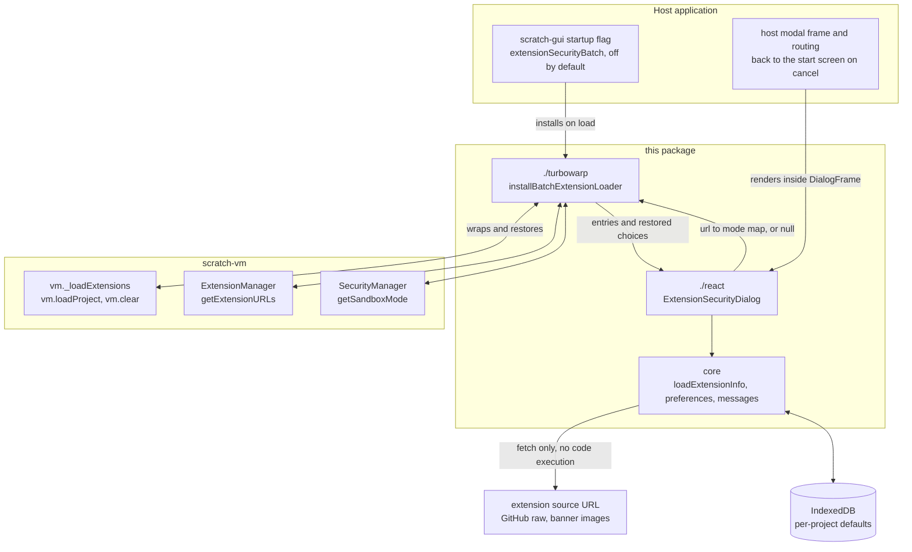
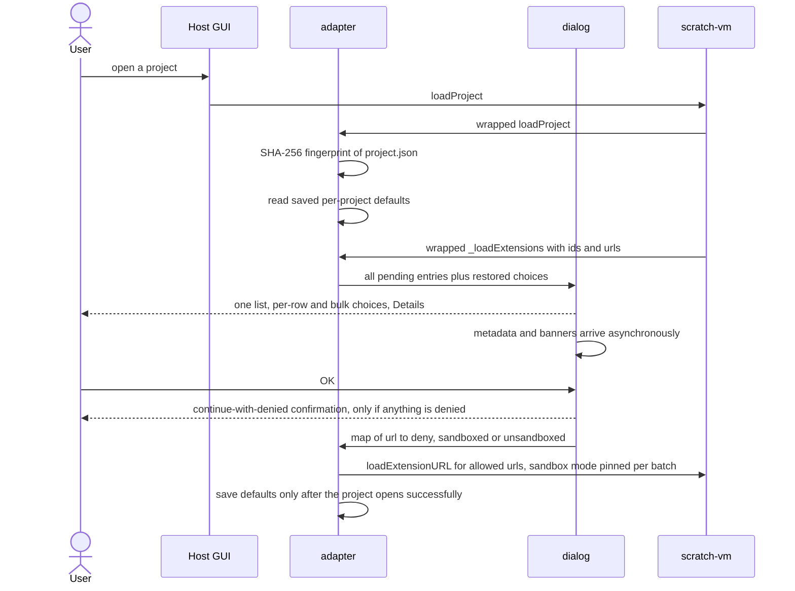

# turbowarp-extension-security-dialog

**English** | [日本語](./README.ja.md)

A shared package that reviews every custom extension a TurboWarp project is about to load
in **one single list**, instead of one prompt per extension.
Related tasks and acceptance criteria are tracked in
[scratch-gui #33](https://github.com/kubohiroya/scratch-gui/issues/33).

## Screenshots from the public Editor

[English](./README.md) and [Japanese](./README.ja.md) use the same dialog with localized labels and extension descriptions.
This capture shows Camera Source 0.19.4, Asset Cache 0.3.2 and Bubble 0.13.5 in the
[public Editor](https://kubohiroya.github.io/turbowarp-extension-data-editor/editor.html?lang=en)
on 25 October 2026.


All three extensions declare `Unsandboxed: required`. **With sandbox** is disabled, with
**This extension cannot run inside the sandbox.** shown as the reason. **Without sandbox**
is marked **Required to run**. Deny remains available, and running still requires an explicit
choice and OK. These labels describe execution requirements, not a safety certification.

| Extension | Why it needs to run without a sandbox |
| --- | --- |
| Camera Source | Accesses the host runtime to share one browser camera stream between extensions and provides camera-selection and mirroring controls. Browser camera permission is a separate decision. |
| Asset Cache | Accesses the host runtime and renderer directly to display and play cached image, audio and runtime-text assets. |
| Bubble | Accesses the host runtime and renderer directly to draw and update layered speech bubbles and portraits on the stage. |

The PNG is an unmodified, modal-only browser capture. Source versions, Editor build and image
hashes are recorded in [the capture manifest](./assets/screenshots/localized-descriptions-20261025.json).

## How it fits together

The package sits between the host GUI and `scratch-vm`. It never patches `scratch-vm`
sources or anything inside `node_modules`: the adapter wraps a handful of instance methods
at runtime and hands back a `restore()` function.



| Package | Relationship |
| --- | --- |
| `scratch-vm` | Wrapped, never modified. `_loadExtensions` is intercepted so that **all** permission decisions are made before the first extension starts; `loadProject` and `clear` scope the batch to one project load; `getSandboxMode` is pinned per batch; `getExtensionURLs` keeps denied blocks' source URLs so re-saving the project does not lose them. |
| `scratch-gui` / TurboWarp Editor fork | The host. It owns the startup flag (off by default), the modal frame passed as `DialogFrame`, and the navigation back to the editor start screen after a confirmed cancel. Host security policy keeps priority. |
| `react`, `react-dom` | Optional peer dependencies, needed only for the React UI. The core and the VM adapter work without them. |
| `@turbowarp/jszip` | Reads `project.json` out of an `sb3` to fingerprint the project for per-project defaults. |

## What the dialog looks like

One dialog per project load, listing every pending extension URL. Each row offers the same
three choices — **Deny**, **With sandbox**, **Without sandbox** — and a bulk control applies
one choice to every listed extension that supports it. The heading, the bulk row and the
OK/Cancel buttons stay visible; only the list scrolls, so the dialog always fits the viewport.

```
+--------------------------------------------------------------------+
| Extension Security                                                 |
| Choose how to run each extension (you can choose while metadata    |
| loads).                                 Extension information: 2/3 |
|                                                                    |
| Apply to all listed: [(x) Deny] [(o) With sandbox] [(!) Without]   |
| Applies only to extensions that support this mode.                 |
| +----------------------------------------------------------------+ |
| | Extension             |  (x) Deny |   (o) With  | (!) Without  | |  <- only this
| +----------------------------------------------------------------+ |     area scrolls
| | [banner] Fetch        |    ( )    | Unsupported |     (*)      | |
| |   Author: ... | ID: fetch | License: MIT | Updated: ...        | |
| |   (!) This extension cannot run inside the sandbox.            | |
| |       Without sandbox: Required to run             [ Details ] | |
| +----------------------------------------------------------------+ |
| | [banner] Storage      |    (*)    |     ( )     |     ( )      | |
| |   Getting metadata...                              [ Details ] | |
| +----------------------------------------------------------------+ |
| Metadata is provided by the author.                                |
| Extensions without a sandbox can access your project and browser   |
| information.                                                       |
| Deny 1 · With 0 · Without 1 · Unselected 1                         |
|                                      [ Cancel ]       [  OK  ]     |
+--------------------------------------------------------------------+
```

Two confirmation dialogs can follow:

- **Cancel loading** — "Cancel loading this project and return to the TurboWarp Editor start
  screen?" Only a confirmed cancel rejects the load; the VM error is identifiable with
  `isExtensionSecurityCancelled(error)`.
- **Continue with denied extensions** — "This project may not work as its author intended
  when it runs. Continue?" Answering *No* returns to the list and saves nothing.

Hovering or keyboard-focusing a banner opens a full-size preview; images larger than the
screen scroll inside the preview frame. *Details* is the only thing that shows extension
source code inline.



## Where this really belongs

**This behaviour should be implemented in TurboWarp Editor itself.** Deciding how to run
untrusted extension code is a security boundary of the editor, not something a project
should have to bolt on: the review has to happen before any extension code runs, it has to
cover every extension in the project at once so the user can judge them together, and its
outcome has to survive a save and reload. A downstream package can only wrap the host's
methods at runtime to get there.

**The author believes this package is useful, and publishes it on that belief.** Until the
upstream editor covers this, any TurboWarp host can adopt the batch review today behind a
flag that is off by default, and the package doubles as a working reference — behaviour,
wording in English and Japanese, and a compatibility boundary — for an upstream
implementation. The author would be glad to see it made redundant by TurboWarp Editor.

## Responsibilities

- Comparison list UI, per-row and bulk three-way choice, confirmation dialogs, source detail view
- Metadata retrieval that never executes extension code, candidate selection between the real
  banner and GitHub images, fallback to a common banner
- Asynchronous image and metadata updates that keep selection and detail state independent
- Per-project IndexedDB storage and restoration of initial choices
- A VM compatibility adapter, isolated in `./turbowarp`

The host provides the dialog frame, the startup flag, and the move back to the start screen
after a cancel. React and React DOM are optional peer dependencies; supply both when using
the React UI. Neither is needed for the core or the VM adapter.

The dialog's total height is constrained to the viewport. The heading, bulk choice and
OK/Cancel stay in place while only the list — including details and notices — scrolls.
Spacing tightens on short viewports.

## Metadata and previews

HTTP/HTTPS origin URLs are shown in full and open in a new tab. Embedded extensions and other
schemes are not linked.

If the leading declaration comment in the source carries an update timestamp such as
`// Updated: 2026-10-19T10:30:00+09:00`, the written value is displayed verbatim.
`Updated at` / `Updated-at` / `UpdatedAt` / `Last updated` / `Last-updated` / `Last modified` /
`Last-modified` are read as the same field. A custom `loadInfo` may return `metadata.updatedAt`.
With nothing declared, no timestamp is shown — it is never substituted from an HTTP response
or a file timestamp.

Run modes remain selectable while metadata is still loading.

### Localized extension descriptions

The dialog reads optional language-tagged header comments, without evaluating extension code:

```js
// Description: Share one camera stream between extensions.
// Description[ja]: 1つのカメラ映像を複数の機能拡張で共有します。
// Description[ja-JP]: 日本語の説明（日本向け）。
```

Tags are case-insensitive. Display selection uses the exact Editor locale, then its base
language, then the original `Description`. A locale change updates the text without refetching
source or changing permission choices. Missing translations keep existing extensions compatible.
Only the enclosing header is used; bundled member notices cannot supply its translation.
HTML-looking text is rendered as text. The optional `ExtensionMetadata.descriptions` record uses
lowercase keys, and `getExtensionDescription(metadata, locale)` exposes the same lookup.

The public Editor and the three published bundles shown above support localized descriptions.
The English capture uses each original `Description`; the Japanese capture uses `Description[ja]`.
Extensions without a matching translation retain their original description. The selected language
does not change required modes or permission choices. Updating a package does not replace code
already embedded in an existing SB3.

## Choosing a run mode

Per-row choices, the bulk choices and the list heading are ordered: **Deny** (prohibition
icon), **With sandbox** (shield), **Without sandbox** (warning). Icons and colour support the
text labels; they are not a safety certification.

If the leading declaration comment contains `// Unsandboxed: required`, *With sandbox* is
disabled with the reason shown, and *Without sandbox* is marked *Required to run*. Deny stays
selectable. This declaration is the author's own claim; a required mode is never inferred from
a missing declaration or a failed fetch.

A choice to run is only committed once metadata has loaded or failed. A selection that
contradicts a late-arriving declaration is cleared — including a restored saved value — and
the user is asked to choose again. The mode is never silently widened. A bulk choice applies
only to extensions that support it, and a bulk button is disabled when no listed extension does.

## Wiring it up

```jsx
import {ExtensionSecurityDialog} from '@kubohiroya/turbowarp-extension-security-dialog/react';
import {installBatchExtensionLoader} from '@kubohiroya/turbowarp-extension-security-dialog/turbowarp';
import '@kubohiroya/turbowarp-extension-security-dialog/styles.css';

const restore = installBatchExtensionLoader(vm, (entries, initialChoices) =>
  new Promise(resolve => showDialog(
    <ExtensionSecurityDialog entries={entries} initialChoices={initialChoices}
      locale="en" DialogFrame={HostModal} onComplete={resolve} />
  )), defaultExtensionURLs);
```

`onComplete` returns the committed `Map`, or `null` for a confirmed cancel. A cancellation
surfacing as a VM error is identified with `isExtensionSecurityCancelled(error)`.
Under Webpack 4 with CSS Modules, load `webpack4.css` instead of `styles.css`; root-level
compatibility entries resolve for older Webpack 4 setups that do not read package exports.

## Stored preferences

Preferences are saved only when OK was pressed **and** the project then opened successfully.
A restored value still requires an explicit OK. A cancel, a *No* at the continue
confirmation, or a failed load never overwrites the stored settings.

A project is identified by the SHA-256 of its `project.json` contents, excluding editor
metadata and JSON key order — never by file name, so a project whose contents changed is
treated as a different project. Stored extension URLs are hashed too; no source code is
copied into the settings database. Where IndexedDB or the crypto API is unavailable,
permission review and loading still proceed.

## Host compatibility boundary

The current adapter wraps `_loadExtensions`, `loadProject` and `clear` on the VM instance,
`getExtensionURLs` on the ExtensionManager, and `getSandboxMode` on the SecurityManager.
It edits neither scratch-vm sources nor dependency packages inside `node_modules`.
Call the returned `restore()` to dispose of the adapter.
In scratch-gui, introduce it behind a startup flag that is off by default, and let the host's
own security policy take precedence.

## Development and verification

```sh
npm install
npm test
```

GUI integration additionally verifies display and storage after a real-VM denial, the
transition to the editor start screen, and IndexedDB restoration in a real browser.
When a GitHub image cannot be fetched, the common banner is used.

## Rollback

Turn the host's `extensionSecurityBatch` off and reload to return to the existing
confirmation path. If needed, revert the shared dependency and the host wiring together as
one change. The saved project format is unchanged.

## License

GPL-3.0-only. See [LICENSE](./LICENSE) and [NOTICE.md](./NOTICE.md) for image attribution.
