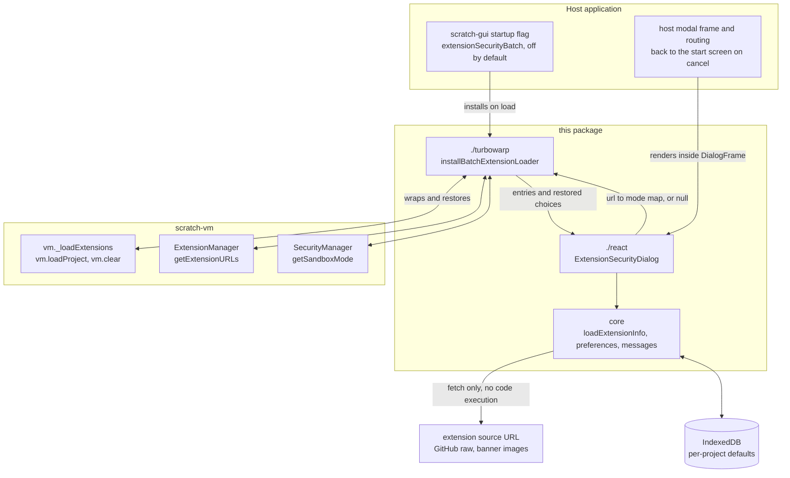
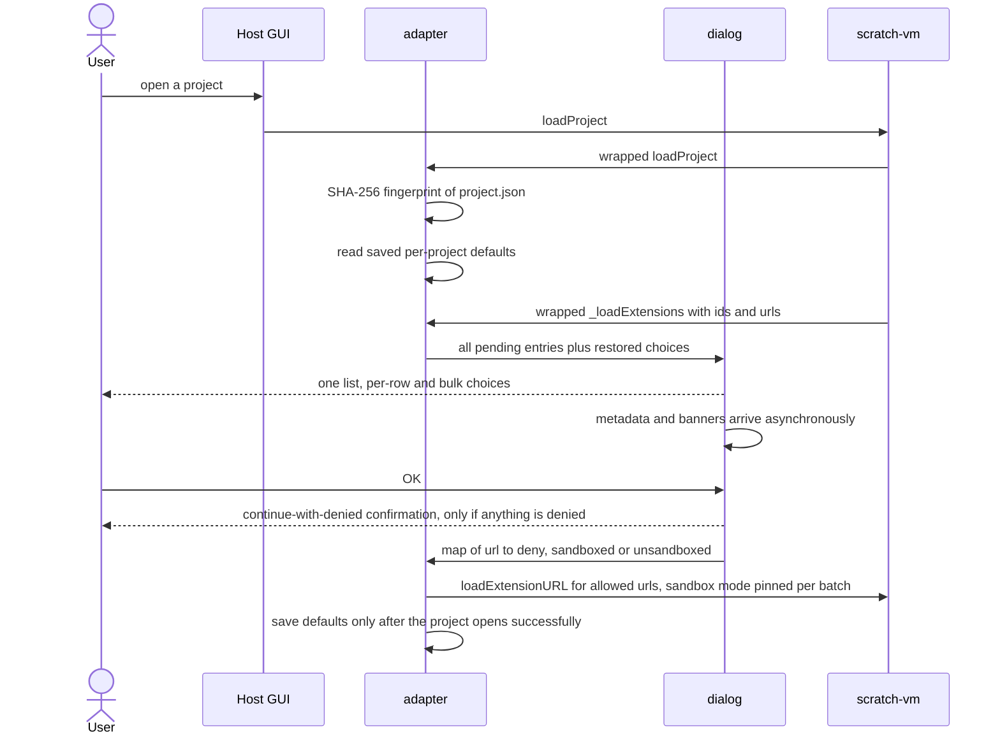

# turbowarp-extension-security-dialog

English | [日本語](README.ja.md)

A shared package that reviews every custom extension a TurboWarp project is about to load
in **one single list**, instead of one prompt per extension.
Related tasks and acceptance criteria are tracked in
[scratch-gui #33](https://github.com/kubohiroya/scratch-gui/issues/33).

## TurboWarp-Plus-Editor and screenshots

[English](./README.md) and [Japanese](./README.ja.md) use the same dialog with localized labels and extension descriptions.
<p><a class="twpe-edit-button" href="https://kubohiroya.github.io/turbowarp-plus-editor/editor.html?lang=en"> Edit in TurboWarp-Plus-Editor</a></p>

The downstream [TurboWarp-Plus-Editor](https://github.com/kubohiroya/turbowarp-plus-editor) owns integrated builds, validation and distribution. Its README also documents the reusable button HTML and stylesheet.

The following capture records the Editor before this migration, on 28 October 2026, with Camera Source 0.19.4, Asset Cache 0.3.2 and Bubble 0.13.5. **Without sandbox** is selected for all three extensions and the unnecessary bulk selection section is hidden. This is a historical capture, not a new image of the current UI.


All three extensions declare `Unsandboxed: required`. **Deny** and **With sandbox** are
disabled, with the reason shown. **Without sandbox** is enabled and marked **Required to run**.
When every listed extension requires this mode, it is preselected after all metadata loads, and the bulk selection section is hidden.
Press OK to continue, or **Cancel** to stop loading the project.
These labels describe execution requirements, not a safety certification.

| Extension | Why it needs to run without a sandbox |
| --- | --- |
| Camera Source | Accesses the host runtime to share one browser camera stream between extensions and provides camera-selection and mirroring controls. Browser camera permission is a separate decision. |
| Asset Cache | Accesses the host runtime and renderer directly to display and play cached image, audio and runtime-text assets. |
| Bubble | Accesses the host runtime and renderer directly to draw and update layered speech bubbles and portraits on the stage. |

The PNG is an unmodified, modal-only browser capture. Source versions, Editor build and image
hashes are recorded in [the capture manifest](./assets/screenshots/hidden-bulk-required-20261028.json).

## How it fits together

The package sits between the host GUI and `scratch-vm`. It never patches `scratch-vm`
sources or anything inside `node_modules`: the adapter wraps a handful of instance methods
at runtime and hands back a `restore()` function.



| Package | Relationship |
| --- | --- |
| `scratch-vm` | Wrapped, never modified. `_loadExtensions` is intercepted so that **all** permission decisions are made before the first extension starts; `loadProject` and `clear` scope the batch to one project load; `getSandboxMode` is pinned per batch; `getExtensionURLs` keeps denied blocks' source URLs so re-saving the project does not lose them. |
| `scratch-gui` / TurboWarp Editor fork | The host. It owns the startup flag (off by default), the modal frame passed as `DialogFrame`, and the navigation back to the editor start screen after a confirmed cancel. Host security policy keeps priority. |
| `react`, `react-dom` | Optional peer dependencies, needed only for the React UI. The core and the VM adapter work without them. |
| `@turbowarp/jszip` | Reads `project.json` out of an `sb3` to fingerprint the project for per-project defaults. |

## What the dialog looks like

One dialog per project load, listing every pending extension URL. Each row offers the same
three choices — **Deny**, **With sandbox**, **Without sandbox** — and a bulk control applies
one choice to every listed extension that supports it. The heading, the bulk row and the
OK/Cancel buttons stay visible; only the list scrolls, so the dialog always fits the viewport.

The security dialog and selection list use the same internal package-description renderer
and category-section helper. They share uncropped images at their original aspect ratio,
GitHub/npm service links, execution-requirement badges and supplied category headings.
Neither view includes a Details button or inline source code. Radio buttons and checkboxes
remain outside the description; selection-state badges use a slot in the shared renderer.

The security dialog explains the warning badge once above the list: “To make extensions
marked ⚠️ work as their creators intended, choose Without sandbox.” Metadata progress
appears below it. With `context="catalog"`, a separate footer row above the buttons says
“Choose Cancel to return to the selection list.” Project context retains its own cancellation
confirmation and does not show that destination.

Two confirmation dialogs can follow:

- **Cancel loading** — "Cancel loading this project and return to the TurboWarp Editor start
  screen?" Only a confirmed cancel rejects the load; the VM error is identifiable with
  `isExtensionSecurityCancelled(error)`.
- **Continue with denied extensions** — "This project may not work as its author intended
  when it runs. Continue?" Answering *No* returns to the list and saves nothing.

Hovering or keyboard-focusing a banner opens a full-size preview; images larger than the
screen scroll inside the preview frame. Thumbnails use the same uncropped display in both views.



## Where this really belongs

**This behaviour should be implemented in TurboWarp Editor itself.** Deciding how to run
untrusted extension code is a security boundary of the editor, not something a project
should have to bolt on: the review has to happen before any extension code runs, it has to
cover every extension in the project at once so the user can judge them together, and its
outcome has to survive a save and reload. A downstream package can only wrap the host's
methods at runtime to get there.

**The author believes this package is useful, and publishes it on that belief.** Until the
upstream editor covers this, any TurboWarp host can adopt the batch review today behind a
flag that is off by default, and the package doubles as a working reference — behaviour,
wording in English and Japanese, and a compatibility boundary — for an upstream
implementation. The author would be glad to see it made redundant by TurboWarp Editor.

## Responsibilities

- Comparison list UI, per-row and bulk three-way choice, confirmation dialogs
- Metadata retrieval that never executes extension code, candidate selection between the real
  banner and GitHub images, fallback to a common banner
- Asynchronous image and metadata updates that preserve selection
- Per-project IndexedDB storage and restoration of initial choices
- A VM compatibility adapter, isolated in `./turbowarp`

The host provides the dialog frame, the startup flag, and the move back to the start screen
after a cancel. React and React DOM are optional peer dependencies; supply both when using
the React UI. Neither is needed for the core or the VM adapter.

The dialog's total height is constrained to the viewport. The heading, bulk choice and
OK/Cancel stay in place while only the list — including notices — scrolls.
Spacing tightens on short viewports.

## Metadata and previews

The security dialog retains its HTTP/HTTPS source-origin URL as a separate provenance line,
opening in a new tab. Embedded source URLs and other schemes are not linked. The selection
list keeps its documentation URL instead; it never displays the JavaScript distribution URL.

Embedded bundles can declare `// Author URL: https://example.org/creator`,
`// Docs URL: https://example.org/docs/` and `// Package: @example/bundle` in the leading
header. Security review displays the declared creator link (with `By`/`Author`), HTTPS
documentation link and npm icon. `Repository`, `Banner`, `Version` and localized descriptions
use the same package renderer. Bundle member notices do not supply the bundle's own fields.

If the leading declaration comment in the source carries an update timestamp such as
`// Updated: 2026-10-19T10:30:00+09:00`, the written value is displayed verbatim.
`Updated at` / `Updated-at` / `UpdatedAt` / `Last updated` / `Last-updated` / `Last modified` /
`Last-modified` are read as the same field. A custom `loadInfo` may return `metadata.updatedAt`.
With nothing declared, no timestamp is shown — it is never substituted from an HTTP response
or a file timestamp.

Run modes remain selectable while metadata is still loading.

### Localized extension descriptions

The dialog reads optional language-tagged header comments, without evaluating extension code:

```js
// Description: Share one camera stream between extensions.
// Description[ja]: 1つのカメラ映像を複数の機能拡張で共有します。
// Description[ja-JP]: 日本語の説明（日本向け）。
```

Tags are case-insensitive. Display selection uses the exact Editor locale, then its base
language, then the original `Description`. A locale change updates the text without refetching
source or changing permission choices. Missing translations keep existing extensions compatible.
Only the enclosing header is used; bundled member notices cannot supply its translation.
HTML-looking text is rendered as text. The optional `ExtensionMetadata.descriptions` record uses
lowercase keys, and `getExtensionDescription(metadata, locale)` exposes the same lookup.

The pre-migration Editor capture and the three published bundles shown above demonstrate localized descriptions.
The English capture uses each original `Description`; the Japanese capture uses `Description[ja]`.
Extensions without a matching translation retain their original description. The selected language
does not change required modes or permission choices. Updating a package does not replace code
already embedded in an existing SB3.

## Choosing a run mode

Per-row choices, the bulk choices and the list heading are ordered: **Deny** (prohibition
icon), **With sandbox** (shield), **Without sandbox** (warning). Icons and colour support the
text labels; they are not a safety certification.

If the leading declaration comment contains `// Unsandboxed: required`, *Deny* and *With sandbox*
are disabled with the reason shown, and *Without sandbox* is the only available mode, marked
*Required to run*. Press OK to approve the selected modes, or Cancel to stop loading
the project. This declaration is the author's own claim; a required mode is never inferred from
a missing declaration or a failed fetch.

A choice, including Deny, is only committed once metadata has loaded or failed. When every
listed extension has loaded metadata declaring this requirement, *Without sandbox* is
preselected for all entries, including entries with incompatible saved choices. Nothing runs
until the user presses OK; Cancel still stops loading the project. Pending, missing, optional
or failed declarations prevent this batch default. In mixed batches, incompatible choices
are cleared and the user is asked to choose again. A bulk choice applies only to extensions
that support it, and a bulk button is disabled when no listed extension does.

## Wiring it up

```jsx
import {ExtensionSecurityDialog} from '@kubohiroya/turbowarp-extension-security-dialog/react';
import {installBatchExtensionLoader} from '@kubohiroya/turbowarp-extension-security-dialog/turbowarp';
import '@kubohiroya/turbowarp-extension-security-dialog/styles.css';

const restore = installBatchExtensionLoader(vm, (entries, initialChoices) =>
  new Promise(resolve => showDialog(
    <ExtensionSecurityDialog entries={entries} initialChoices={initialChoices}
      locale="en" DialogFrame={HostModal} onComplete={resolve} />
  )), defaultExtensionURLs);
```

`onComplete` returns the committed `Map`, or `null` for a confirmed cancel. A cancellation
surfacing as a VM error is identified with `isExtensionSecurityCancelled(error)`.
Under Webpack 4 with CSS Modules, load `webpack4.css` instead of `styles.css`; root-level
compatibility entries resolve for older Webpack 4 setups that do not read package exports.

## Selecting extensions from a Pages catalog

`ExtensionSelectionList` shares the security dialog's banners and metadata,
with one checkbox at the right of each row. This API supports the TurboWarp Plus library
tracked in [#28](https://github.com/kubohiroya/turbowarp-extension-security-dialog/issues/28).
The host fetches a versioned JSON catalog over HTTPS:

```jsx
import {loadExtensionCatalog} from '@kubohiroya/turbowarp-extension-security-dialog';
import {ExtensionSelectionList} from '@kubohiroya/turbowarp-extension-security-dialog/react';

const controller = new AbortController();
const entries = await loadExtensionCatalog(
  'https://kubohiroya.github.io/turbowarp-plus-packages/extensions-v1.json',
  controller.signal
);

const list = <ExtensionSelectionList entries={entries} locale="en"
  filterQuery={searchText} loadedIds={loadedExtensionIds} busy={loading}
  onCancel={closeLibrary}
  onComplete={ordered => host.reviewAndLoadInOrder(ordered)} />;
```

`host.reviewAndLoadInOrder` represents the host's permission review and VM loading path.
The callback receives dependencies before their dependants, each once, excluding
`loadedIds`. Selecting an extension checks and disables all transitive dependencies.
Removing its selection recomputes the closure; dependencies remain checked if another
selection needs them or the user selected them explicitly. Loaded rows are checked and
disabled. Search and locale changes preserve selection. `busy` disables selection and the
footer controls. The host owns fetch errors, retry, catalog cancellation, VM errors, and
updating `loadedIds` after each successful load.

Rows distinguish **Selected by you** (blue), **Selected automatically** (purple), and
**Not selected** (neutral), using a background, left border, icon and label together.
Already loaded rows have their own label and accent. A legend explains the states above
the list. Automatically selected dependencies name every selected root that needs them,
for example “Required by Bubble, Sprite”. An explicitly selected dependency keeps its
“Selected by you” state while another root requires it; its checkbox stays disabled and
the dependency reason is also shown. The row's `data-selection-state` is `selected`,
`dependency`, `unselected` or `loaded`.

Optional catalog categories render as semantic `h2` sections in dashboard order. Japanese
uses `titleJa` when available, otherwise `title`; other locales use `title`. Search hides
empty sections without changing selection. Catalogs without categories
keep a flat list. If categorized and uncategorized entries are mixed, the latter appear
under “Other extensions” at the end. Theme colors use the host's modal background and
foreground; accent overrides are `--twextsec-manual-accent`, `--twextsec-dependency-accent`,
`--twextsec-unselected-accent`, and `--twextsec-loaded-accent`.

Package selection states and dependency reasons appear below the preview image. The heading places the name, version, parenthesized ID and GitHub/npm icons in that order. Items after the name use regular weight and a font size 2pt smaller than the name, wrapping as needed.

The selection list never loads or runs extension code. Catalog metadata renders immediately.
It shows the verified GitHub Pages `docsURL`, and GitHub/ npm icon links to the repository
and package page. Neither screen has a Details control or inline source; the JavaScript
distribution URL remains confined to the security dialog’s provenance line.
Creator names use `authorURL` only when explicitly supplied by the published package.json
`author.url`. Every row discloses its unsandboxed requirement as required, optional, not needed
or not confirmed; required mode includes a warning icon. `ExtensionSecurityDialog context="catalog"` provides permission review with cancel
wording that returns to this list; its default `context="project"` retains project wording.
The host must respect the committed execution modes and its own security policy.

For shared images, service links and execution requirements, optional `entry.metadata`
complements the fetched source metadata. If either declares `unsandboxed: required`, the
shared badge, allowed choices, invalidation and batch defaults all honor that requirement.
Security still waits for source metadata to settle (success or failure) before accepting OK;
fetching declarations never executes the code. Security uses the source-header version,
explicit creator/documentation links and source provenance; a creator without a URL stays
plain text. Selection keeps catalog versions and links. Supplied `entry.category` is rendered in either view;
category-free project entries stay flat without any catalog lookup or inferred category.


The Pages document has the following contract (`schemaVersion: 1`):

```json
{
  "schemaVersion": 1,
  "categories": [{"id": "camera", "title": "Camera", "titleJa": "カメラ"}],
  "extensions": [
    {
      "id": "cameraSource",
      "name": "Camera Source",
      "category": "camera",
      "version": "1.2.3",
      "package": "@example/camera-source",
      "url": "https://cdn.jsdelivr.net/npm/@example/camera-source@1.2.3/dist/extension.js",
      "description": "Share a camera stream.",
      "descriptions": {"ja": "カメラ映像を共有します。"},
      "repository": "https://github.com/example/camera-source",
      "banner": "https://example.com/camera-source.svg",
      "unsandboxed": "required",
      "dependencies": []
    }
  ]
}
```

IDs contain ASCII letters and digits. `name`, `version`, `url`, and `dependencies` are
required. Dependencies are extension IDs in this document, not npm package names;
the generator resolves package dependencies to these IDs. `package`, descriptions, author,
license, banner, repository and execution requirement are optional metadata. The generator
uses version-pinned, published distribution URLs and excludes build-only packages.
`parseExtensionCatalog` rejects unsupported schemas, duplicate IDs/URLs, missing dependencies,
cycles, and non-HTTPS or credential-bearing URLs before the UI or VM receives entries.
`resolveExtensionSelection(entries, explicitIds, loadedIds)` exposes the same closure and
load order independently of React. Its `requiredBy` map associates each dependency ID with
a set of the explicit root IDs that require it, including transitive and shared dependencies.
Optional `categories: [{id, title, titleJa?}]` are declared once, in dashboard order;
`extensions[].category` references one of those IDs. Duplicate category IDs, invalid
definitions and unknown references are rejected. `parseExtensionCatalog` retains its array
return type and resolves each reference to `entry.category: {id, title, titleJa?, order}`.
`loadExtensionCatalog` accepts an optional AbortSignal,
omits credentials/referrers, and rejects failed HTTP responses or invalid JSON contracts.

To roll back catalog integration, turn off the host's startup flag (off by default) and
reload, or revert the catalog wiring. The existing three-way security dialog remains
available without the catalog API.

## Stored preferences

Preferences are saved only when OK was pressed **and** the project then opened successfully.
A restored value still requires an explicit OK. A cancel, a *No* at the continue
confirmation, or a failed load never overwrites the stored settings.

A project is identified by the SHA-256 of its `project.json` contents, excluding editor
metadata and JSON key order — never by file name, so a project whose contents changed is
treated as a different project. Stored extension URLs are hashed too; no source code is
copied into the settings database. Where IndexedDB or the crypto API is unavailable,
permission review and loading still proceed.

## Host compatibility boundary

The current adapter wraps `_loadExtensions`, `loadProject` and `clear` on the VM instance,
`getExtensionURLs` on the ExtensionManager, and `getSandboxMode` on the SecurityManager.
It edits neither scratch-vm sources nor dependency packages inside `node_modules`.
Call the returned `restore()` to dispose of the adapter.
In scratch-gui, introduce it behind a startup flag that is off by default, and let the host's
own security policy take precedence.

## Development and verification

```sh
pnpm install
pnpm test
```

GUI integration additionally verifies display and storage after a real-VM denial, the
transition to the editor start screen, and IndexedDB restoration in a real browser.
When a GitHub image cannot be fetched, the common banner is used.

## Rollback

Turn the host's `extensionSecurityBatch` off and reload to return to the existing
confirmation path. If needed, revert the shared dependency and the host wiring together as
one change. The saved project format is unchanged.

## License

GPL-3.0-only. See [LICENSE](./LICENSE) and [NOTICE.md](./NOTICE.md) for image attribution.
