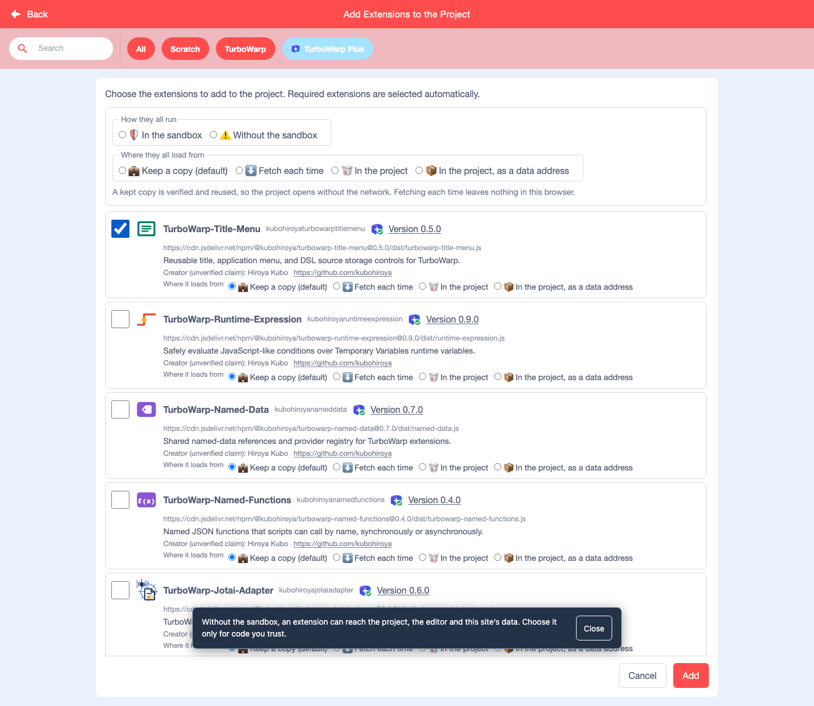
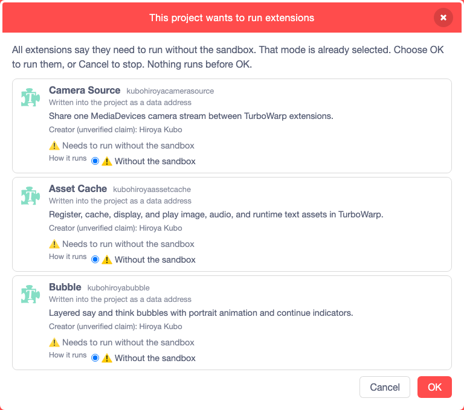

# @kubohiroya/turbowarp-extension-security-dialog

One screen that asks how a project's extensions may run, and the wiring that puts it in front of
a person before any extension code starts.

Licensed under [MPL-2.0](LICENSE). It carries no "Incompatible With Secondary Licenses" notice, so
it can be combined into a larger work distributed under GPL-3.0 — which is how the TurboWarp-Plus
Editor ships it.

## The problem it solves

A VM loads extensions one at a time and asks about each as it goes. Opening a project becomes a
queue of prompts, and the first extension starts before the person has seen the last one. Adding
an extension asks twice: once to pick it, once to allow it.

This package collects the whole project, puts one question, and only then loads anything.

## Extension review in the public Editor

These screenshots were taken on 6 November 2026 in the
[public TurboWarp Plus Editor](https://kubohiroya.github.io/turbowarp-plus-editor/editor.html?lang=en)
with security dialog 0.8.5.

**Add extensions.** In the TurboWarp Plus catalog, selecting TurboWarp-Title-Menu shows a
dismissible warning about running without the sandbox. The row shows loading options with
icons and links to the extension page, release notes and creator contact. Cancel and Add
stay visible as the list scrolls. Closing the warning keeps the selection.



**Open a project.** This SB3 stores Camera Source 0.19.4, Asset Cache 0.3.2 and Bubble 0.13.5
as `data:` URLs. All three declare that they require unsandboxed execution, so the dialog
preselects the execution mode. The older screenshot below waits for OK or Cancel. No extension has run at
the point shown.



See the [capture record](./assets/screenshots/public-review-20261106.json) for the deployed
revisions, bundle integrity, image hashes and interaction checks, and the
[Japanese README](./README.ja.md) for the same screens in Japanese.

## Entry points

| Import | What it is |
| --- | --- |
| `.` | Reading a catalog, reading an extension's own description, closing a selection over its dependencies, remembering what the opener chose, the wait dialog, wording |
| `./react` | `ExtensionReview`, the screen, and `ExtensionRow`, one row of its list |
| `./turbowarp` | `installBatchExtensionLoader`, which wraps a VM so the question comes first |
| `./styles.css`, `./webpack4.css` | The screen's styles; the second has class names wrapped in `:global()` for a CSS-modules build |

## The screen

```tsx
import {ExtensionReview} from '@kubohiroya/turbowarp-extension-security-dialog/react';
import '@kubohiroya/turbowarp-extension-security-dialog/styles.css';

<ExtensionReview
    mode="open"            // or "add"
    entries={entries}
    locale="ja"
    DialogFrame={HostModal} // used only when opening
    loadInfo={loadExtensionInfo}
    onComplete={decisions => {/* a Map, or null when the person said no */}}
/>
```

Adding and opening share the component. Opening first presents information and three actions:
Do not run, Review each extension, and Enable all and run. Individual review shows exclusive
pressed buttons without execution icons and a separate final confirmation. Changing mode grants no permission.

| | `add` | `open` |
| --- | --- | --- |
| What is listed | Catalog entries; dependencies are selected for you | Every extension the project uses |
| Picking | Tick to choose | None: the project already names them |
| How it runs | In the sandbox, or without it | In individual review: Do not run, Run in the sandbox to try it out, Trust and run without the sandbox |
| Where it loads from | Any of the four forms | Information in the overview; cache choices in individual review |
| All at once | Both choices | Enable all and run; cache choices remain available in individual review |

### The four loading forms

An extension's bytes are held in one of four ways, spelled the same by the Loader's manifest, by
the SB3 save format and by this screen, so a host wires the two ends together without a
translation table.

| Form | This browser | The project file | Standard TurboWarp |
| --- | --- | --- | --- |
| `remote-non-cacheable` | Keeps nothing | A reference | Cannot open it |
| `remote-cacheable` | May keep a verified copy | A reference | Cannot open it |
| `embedded-file` | Nothing to keep | The bytes, as a file in the archive | Cannot open it |
| `embedded-data` | Nothing to keep | The bytes, as a `data:` value | **Can open it** |

**All four are the author's decision**, made when the extension was added, which is why `add`
offers all of them and `open` offers almost none. The one thing left to the person opening a
project is whether a `remote-cacheable` row actually leaves its copy in this browser, and that can
only be declined: `remote-non-cacheable` is the author forbidding the copy, and there is no way to
write permission back over it. So `loadingChoices` reads the choices off the row's own source and
needs no table beside it — a row whose source names a form is already loading that way, and the
screen states it instead of asking.

### Execution, trust and remembered choices

**When opening a project whose extensions all declare unsandboxed execution required, that mode is preselected.**
This applies only to a non-empty list with every declaration initially available and no failed row.
Individual review still permits denial or a sandbox trial, with a warning for a contradictory trial.
Late declarations do not overwrite the selected mode. Nothing runs before explicit bulk or individual
confirmation. Loading-source and cache-decline choices remain independent.

For ordinary page navigation, the Editor goes back to the preceding page on cancellation. Its GUI
modal receives `manageHistory: false` to avoid another entry just for showing the dialog. Another
project opens in a new tab, leaving unsaved edits, undo history and running state in the original tab.
It does not automatically snapshot or reload the original project.
Direct project URLs do not insert a start page into history. Their stopped screen disables Back
when no previous page is available and offers an explicit action to return to confirmation for
the same project. The dialog title explicitly identifies it as a confirmation.

Adding from the catalog, or opening a mixed, optional, undeclared or failed batch, keeps the sandbox
as the default and leaves the execution choices available. A choice contradicting a declaration is warned about.

**The host identifies trusted rows** through `entry.state.trusted`. The dialog marks those rows
as trusted and sets them to run without the sandbox. The host can skip review for a project
whose rows are all trusted using `requiresReview`.

**A remembered answer is honoured only where it is still one of the choices.** A project that
moved from `remote-cacheable` to embedded bytes, or a row that has since become trusted, does not
carry a stale answer into a screen that no longer offers it.

In add mode, the checkbox, preview icon and extension name appear together. The catalog area
scrolls independently of Cancel and Add. Dismissing the unsandboxed notice preserves the selection
and returns focus to the control that opened it.

Individual review keeps its top action visibly selected and disabled. Rows use the host's icon or
the source's declared banner. Gallery images are resolved against the official catalog by the
full extension URL, independently of source metadata loading. Missing or broken pictures use
an unbranded common icon. Picture loading never grants execution permission.
Gallery banners use a 180 by 90 area, with other extension previews sharing its 90px height. Square family block SVGs fill its height and
stay centered without distortion. Opening a project can resolve the same catalog artwork by
its URL and pinned digest. Narrow screens stack the description and preview and scale the area to fit.
Display metadata can be read from HTTP(S), and relative banners resolve against the final source URL.
When CORS prevents caching an image, it can still be displayed directly by the browser.

For trusted entries, the trust badge links to the extension page when provided. Supported
GitHub versions link to their release notes. The description preserves line breaks and turns
HTTP(S) URLs and email addresses into links. The creator's contact appears next to their name
when supplied.

Execution trust and family membership are separate: only rows with host-confirmed
`entry.state.plusFamily` use the Plus mark. Other trusted rows use an unbranded check.
For a standalone `ExtensionRow`, pass `plusFamily` explicitly after checking the host's Plus
catalog. Extension-declared metadata and matching IDs alone do not establish membership.
When a project opens, an extension the project carries as a `data:` address is matched by the
SHA-256 of its bytes. A listed digest makes the row trusted, family-marked and pictured like the
catalog's own, and its source line names the catalog's address for the same code
(`entry.state.listedURL`); embedded Plus manifest rows do the same. Unlisted bytes are asked about.
An `embedded-file` row of a Plus manifest also shows the picture (`Banner`), creator (`By` / `Author URL`) and
description from the header of its bytes, once they match the pinned SHA-256. A header naming another `ID` lends only
its name, and the manifest's `version` and `publisher` win over the header. These are claims, never permissions or a
resource declaration.
When one release ships an extension in more than one build (an authoring and a playback build, say), its catalog item
can list the others as `variants: [{url, sha256}]`. Bytes of any listed build match that extension, and `listedURL` is
the address of the build that matched. Adding from the library always uses `url`. `catalogDigests(entries)` returns the
digests of every listed build.

### Using one row of the list

`ExtensionRow` draws the same row the screen draws for each extension: its name (with a checkbox, if it can be chosen), IDs, trusted mark, version with a link to its release notes, picture, description, and creator with contact. Another screen that lists extensions shows them the same way. In TurboWarp Plus Editor, the screen that chooses which block palette groups to show uses it.

```tsx
import {ExtensionRow} from '@kubohiroya/turbowarp-extension-security-dialog/react';
import '@kubohiroya/turbowarp-extension-security-dialog/styles.css';

<ul>
    <ExtensionRow
        metadata={{name: 'Pen Plus', author: 'Creator', version: '2.0.0'}}
        ids={['penplus']}
        locale="en"
        pick={{checked: shown, onToggle: () => setShown(!shown)}}  // leave out for no checkbox
        itemProps={{'data-key': 'penplus'}}
    >
        {/* the host's own content, after the creator */}
    </ExtensionRow>
</ul>
```

`details` goes between the heading and the picture; the review screen puts the source and digest there. `children` goes after the creator; the review screen puts its execution and loading choices there. The row is an `<li>`, so put it in a `<ul>` or `<ol>`. When `pick.disabled` is set, neither the checkbox nor the picture changes the choice.

### When loading fails

```tsx
<ExtensionReview
    /* ...as above */
    failure={{code: error.code, message: error.message, retryable: isWorthAskingAgain(error)}}
    onRetry={() => loadAgain()}
/>
```

`failure` is a failure of the whole load, shown above the rows; a row's own failure goes in its
`state.error`, which takes the same optional `retryable`. Both follow one rule:

| `retryable` | `onRetry` given | What the screen shows |
| --- | --- | --- |
| `true` | yes | The code and message, "This may be a network problem" and a **Try again** button that calls `onRetry` |
| `true` | no | The code and message only |
| `false` or missing | either | The code and message only |

With no `failure` the screen renders exactly as it did before these props existed.
Only `message` is required: `failure={{message: 'Could not fetch'}}` displays the failure without
retry controls. `code` is optional display text, and `retryable` defaults to no retry.

Published packages include `dist/build-info.json`, also exported as
`@kubohiroya/turbowarp-extension-security-dialog/build-info`. It records `name`, `version`, the full
source `revision` and `sourceState` (`commit`, `working-tree` or `git-archive`). Hosts can pin the exact version
and verify its revision before deployment. To roll back, restore the previous package version and
lockfile; to hide the new failure UI, stop passing `failure` and `onRetry`.

**The screen keeps no table of error codes.** Whether asking again could change the outcome is the
host's judgement — the Loader's `isWorthAskingAgain` in the TurboWarp-Plus Editor — passed in as a
boolean. A code cannot decide it: `LOAD_FAILED` comes both from a dropped connection, where trying
again may work, and from an extension that registered a different ID, where it never will. Offering
"try again" for the second would be advice the screen cannot back.

## While a fetch is waiting

```js
import {createExtensionWaitDialog} from '@kubohiroya/turbowarp-extension-security-dialog';

const wait = createExtensionWaitDialog(document, locale);
// The Loader reports each retry; show() opens the dialog once the wait looks real.
const ports = createFetchPort(fetch, {onRetry: info => wait.show(info)});
// hide() on every path out, resolved or failed; dispose() when the host goes away.
```

Fetching one extension can stall for seconds while the transport asks again, and the whole
operation is blocked while it does: every row has to be verified and answered for before any of
them is registered. So this takes the middle of the screen, where the question that follows
appears too, rather than a corner.

It carries **no close and no cancel button**, on purpose. Closing would not stop the fetch, and
stopping one halfway has no rollback behind it yet, so either button would offer control that
does not exist and could leave the project in a state nothing restores. Escape is refused for the
same reason.

Showing is delayed by `delayMs` (300 by default), because the shortest wait is one backoff: a
dialog that appeared and vanished inside half a second would read as a flicker and steal focus
for nothing. It carries its own styles, injected once per document, because not every host is a
CSS pipeline — the single-HTML runtime and the packager page build JavaScript only.

## Wiring a VM

```js
import {installBatchExtensionLoader} from '@kubohiroya/turbowarp-extension-security-dialog/turbowarp';
import {createDecisionStorage} from '@kubohiroya/turbowarp-extension-security-dialog';

const uninstall = installBatchExtensionLoader(vm, review, defaultURLs, createDecisionStorage(), {
    collectEntries: async project => /* rows the host owns, e.g. from a Plus manifest */ [],
    applyDecisions: decisions => /* drive the Loader's trust and caching from the same answer */ {},
    identify: async project => /* how this host names a project */ null
});
```

It loads nothing but ordinary custom extensions itself. Rows a host collects belong to whatever
fetched and verified them — the Loader, in the TurboWarp-Plus Editor — so they arrive through
`collectEntries` and leave through `applyDecisions`. This package never needs the Loader's types
or its code, and the dependency points one way: it defines the port, hosts implement it.

Saying no resolves `onComplete` with `null`, and the load rejects with an error that
`isExtensionSecurityCancelled` recognises, so a host can tell a refusal from a fault.

## What is remembered, and where

| What | Where | Who decides |
| --- | --- | --- |
| Which of the four loading forms | The project | Whoever added the extension |
| How it runs, when added | The project | Whoever added it |
| How it runs, when opened | This browser, per project | Whoever opens it |
| Whether a `remote-cacheable` copy is kept | This browser, per project | Whoever opens it, and only to decline |
| Preview pictures | This browser | Nobody; always kept |

Every read answers with something usable even when storage is unavailable — a private window, a
browser with site data blocked — so a screen built on this never fails to open.

## What it never claims

A name, an author, a version, a licence: all of these are the extension's own words, parsed out
of its leading comment, and the screen labels them as unverified. Nothing here evaluates an
extension. A preview picture is decoration and is checked against nothing; whatever verifies the
code does so elsewhere, and a row says so when it failed.

Two forms of leading comment are read: the `// Name: ...` lines TurboWarp's own extensions and its
gallery open with, and a `/** @name ... */` block. Where both name a field, the block wins. Only the
leading run of comment lines counts as a header, and reading stops at `Bundled extensions:`, because
what a bundle says about its members is theirs, not its own.

## Development

```sh
pnpm install
pnpm run typecheck
pnpm run check   # build, unit tests, and a packing dry run
node --test test/wait.browser.ts test/review.browser.ts
```

React and React DOM are peer dependencies, so the host supplies them. There are no runtime
dependencies.

`test/load-errors.test.cts` carries the three error-description and cancellation-classification cases from [Editor #741](https://github.com/kubohiroya/turbowarp-plus-editor/issues/741). It tests the built `./load-errors` entry through the existing `pnpm test` and CI commands, without a GUI checkout or browser. It covers a named nested cause, aggregate errors with cycles, and refusal versus cancellation. The Editor originals stay until this migration is merged with successful CI; Editor keeps its tests of GUI error forwarding and review keyboard ownership. Revert the added test and its documentation to undo the migration. No production source, dependencies, or package version change is needed.

`test/permission-ui.test.cts` also carries the eight permission-dialog, diagnostic-log and retry-display cases from Editor #741. The existing `pnpm test` and CI run the built `./permission-ui` entry without a GUI checkout or VM. Test bodies are preserved; only imports and DOM query type annotations change. Editor keeps its real-VM consent wiring tests. Its originals stay until this migration is merged with successful CI. Revert the added tests and documentation to undo this migration, restoring the Editor originals first if they were removed.

## License

[MPL-2.0](LICENSE). See [NOTICE.md](./NOTICE.md) for what is and is not covered.

The migrated `test/load-errors.test.cts` and `test/permission-ui.test.cts` retain their original GPL-3.0-or-later license; its text is in `test/LICENSE.GPL-3.0`. Tests and this test-only license are excluded from the npm archive. The library remains MPL-2.0.

The design record of the MPL-2.0 rewrite in 0.6.0 is in [the rewrite design (Japanese)](docs/mpl-rewrite.ja.md).

When npm prepares a pinned GitHub archive without `.git`, the installer must pass its locked full SHA as `TWEXTSEC_SOURCE_REVISION`. The build records `sourceState: "git-archive"` and fails without a full SHA; the host verifies it against its manifest and lockfile.

## Resource declarations

Catalog metadata may contain `resourceDeclaration`, following `@kubohiroya/turbowarp-extension-manifest/resources` 0.6.0. The add screen and project-open review use the same `ExtensionRow` disclosure: original SVG icons, visible localized labels, conditional use, purposes, providers and network direction/content. Missing declarations and explicit empty lists have distinct labels. The optional field is display-only and does not grant execution or browser permission.

The project-review port resolves declarations before asking. A declaration belongs to a catalog ID and exact URL/digest; embedded and legacy inline code are matched by digest. A project-supplied package name or declaration cannot borrow another version's claim. An unavailable catalog leaves the declaration unknown and does not block denial/cancellation. Existing host integration ports suffice; Scratch GUI code is unchanged. Roll back to 0.11.0 and the previous dependencies to remove the display.

Resource disclosures show only icons by default. Click the icon row or press Enter/Space to expand or collapse the labels and details. Accessible names remain available while collapsed.
